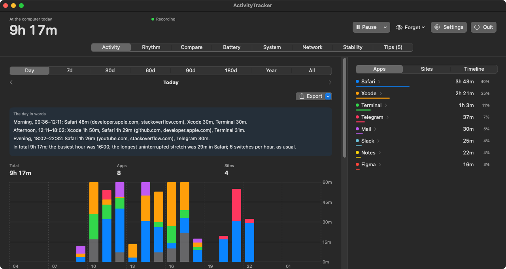
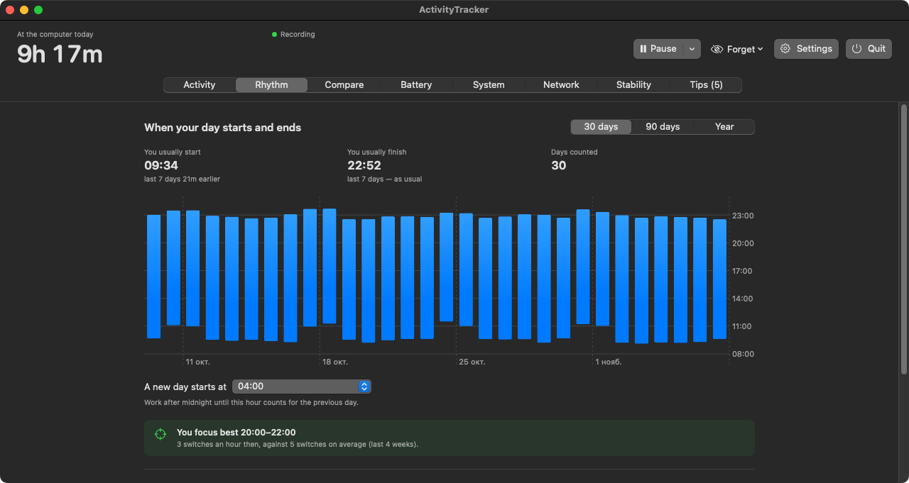
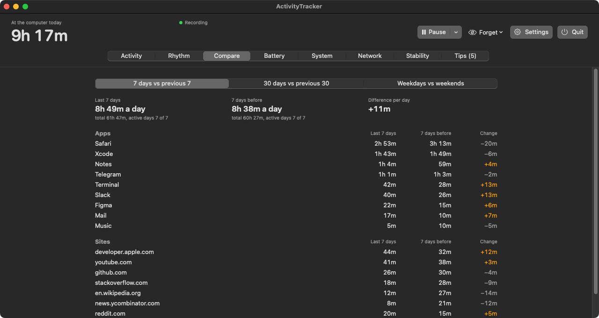
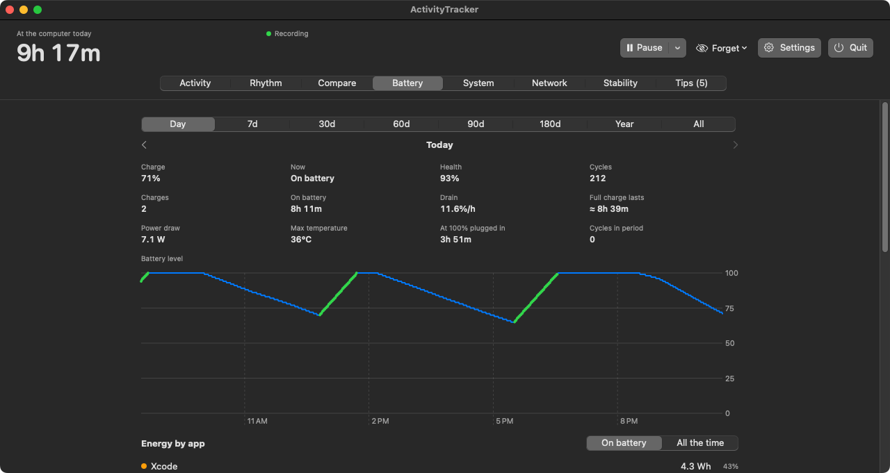
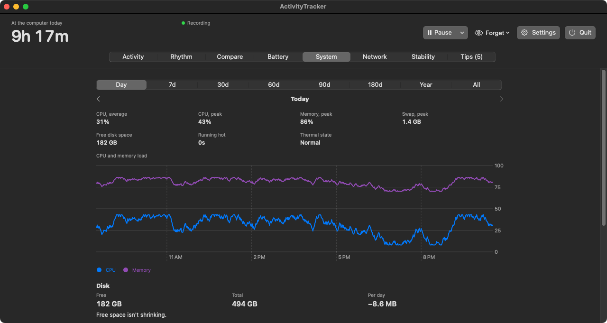
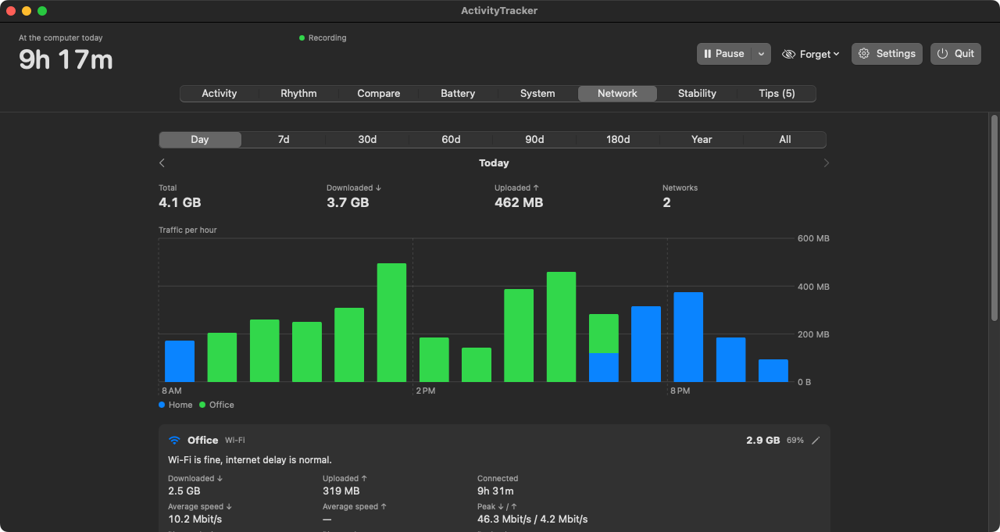
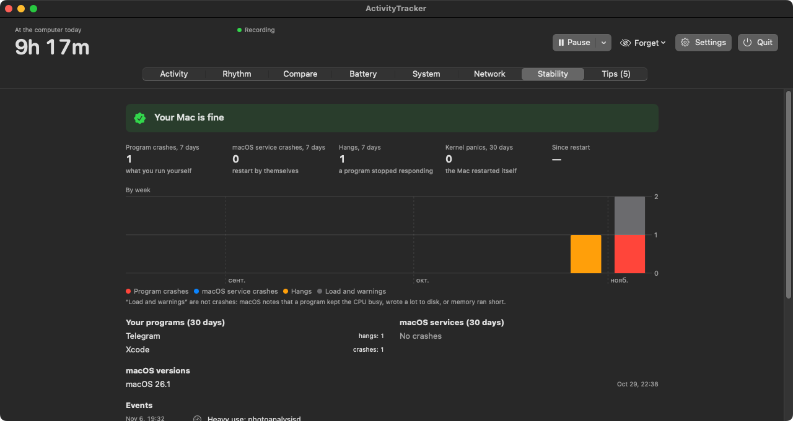
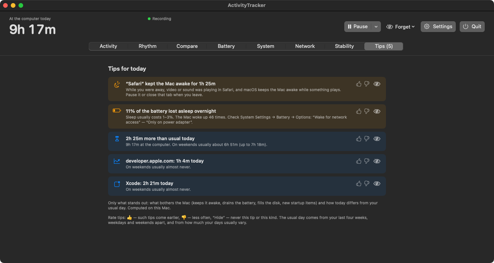

<p align="center">
  
</p>

<h1 align="center">ActivityTracker</h1>

<p align="center">
  <b>A private time and Mac-health tracker for macOS.</b><br>
  How long you were at the computer, in which apps and on which websites, what drains the battery and what keeps
  your Mac awake.<br>
  Everything is computed and stored on your Mac only.
</p>

<p align="center">
  <a href="https://github.com/iopew/activity-tracker-releases/releases/latest/download/ActivityTracker.zip"><b>⬇︎ Download the latest version</b></a>
  &nbsp;·&nbsp; macOS 13 or later &nbsp;·&nbsp; Apple Silicon and Intel
</p>

<p align="center">
  
</p>

---

## What it does

**Time**
- Every 5 seconds it records the active app, the window title and the website in your browser (Safari, Chrome, Arc, Edge, Brave, Firefox…).
- Idle time, sleep and a locked screen don't count. Private browser windows are never recorded.
- Day, 7, 30, 60, 90, 180 days, a year or all time: an hourly chart, an "every minute of the day" grid, apps, websites and a timeline.
- **Rhythm:** when you usually start and finish, a year calendar, and the hours when you focus best.
- **Compare:** this week against the last one, weekdays against weekends, a 90-day trend for any app or website.
- **Switching:** how often an hour you jump between apps, and your most frequent back-and-forth pairs.

**Your Mac**
- **Battery:** charge and drain by day, what drains it the most, how much was lost overnight while asleep, health and cycles.
- **System:** CPU, memory and swap, disk space with a forecast of when it runs out, new login items.
- **Network:** traffic per network (Wi-Fi by name, Ethernet, iPhone hotspot), speed, ping, packet loss and outages.
- **Stability:** app crashes and hangs, restarts, macOS updates.

**Tips**
- Only what stands out: who kept the Mac awake, what drains the battery, how long the charge will last, how today differs from your usual days.
- They learn from you: 👍 brings such tips earlier, 👎 makes them rarer, "Hide" removes them for good.
- "A usual day" comes from your last four weeks, with weekdays and weekends kept apart.

**Also**
- Menu bar: today's time at a glance, statistics in a popover.
- A summary every evening, a weekly summary on Mondays, break reminders at natural pauses.
- Export to CSV and JSON, an `activitytracker` command for the Terminal, SQL over your own history.
- English and Russian, light and dark themes.
- Updates itself, and macOS permissions survive updates.

## Screenshots

*Screenshots show made-up demo data. They are taken automatically with every release.*

| | |
|---|---|
|  <br> **Rhythm:** start and end of the day, calendar, focus hours |  <br> **Compare** weeks, weekdays and weekends, trends |
|  <br> **Battery:** drain, what uses energy, nights |  <br> **System:** CPU, memory, disk |
|  <br> **Network:** traffic, speed, ping, outages |  <br> **Stability:** crashes, hangs, restarts |
|  <br> **Tips** that learn from your ratings | |

## Install

1. **[Download `ActivityTracker.zip`](https://github.com/iopew/activity-tracker-releases/releases/latest/download/ActivityTracker.zip)** and unzip it (double-click).
2. The app isn't signed with an Apple Developer certificate, so macOS won't open it with a double-click. Open **Terminal** in your Downloads folder and run:
   ```bash
   xattr -dr com.apple.quarantine ActivityTracker.app
   rm -rf /Applications/ActivityTracker.app && mv ActivityTracker.app /Applications/
   open /Applications/ActivityTracker.app
   ```
3. On the first launch the app **restarts itself once**: it signs itself with a permanent key created on your Mac, so permissions survive updates.
4. Grant permissions:
   - **Accessibility** (System Settings → Privacy & Security) to record window titles;
   - **Automation** for your browsers (macOS asks on its own) to record websites;
   - **Location Services**, optional, only to see Wi-Fi network names (macOS requires it).

That's it: new versions install themselves. To check by hand: Settings → "Check now".

## Privacy

- **Your data never leaves your Mac.** The history lives in `~/Library/Application Support/ActivityTracker/` and is readable by your user only. No accounts, no cloud, no analytics.
- **The only request to the internet** is the update check on this page every 30 minutes, and you can turn it off. The Network section pings your router and 1.1.1.1.
- **Private browser windows** are not recorded.
- **Secrets are stripped from addresses:** sign-in codes, tokens and password-reset links are never stored.
- You can turn off recording of titles and websites, pause recording, and delete anything: a website, an app, the last 15 minutes, an hour, a day or everything.

## FAQ

<details>
<summary><b>Why do I need the Terminal to install it?</b></summary>

Without a paid Apple Developer certificate ($99 a year) macOS marks downloaded apps as unverified. The `xattr` command removes that mark from this one app. After that, updates install themselves and you won't need the Terminal again.
</details>

<details>
<summary><b>How much does it use?</b></summary>

Almost nothing: one check every 5 seconds and a write to a local database. Every build measures its own CPU and memory use automatically. Half a year of history takes a few megabytes.
</details>

<details>
<summary><b>How do I uninstall it?</b></summary>

```bash
pkill -x ActivityTracker
rm -rf /Applications/ActivityTracker.app
rm -rf ~/Library/Application\ Support/ActivityTracker
rm -rf ~/Library/Caches/com.iopew.ActivityTracker ~/Library/Logs/ActivityTracker
defaults delete com.iopew.ActivityTracker
```
Then remove ActivityTracker from Accessibility, Automation and Login Items in System Settings.
</details>

<details>
<summary><b>Where is the source code?</b></summary>

The source code is private. Only the builds and this page are published here.
</details>
